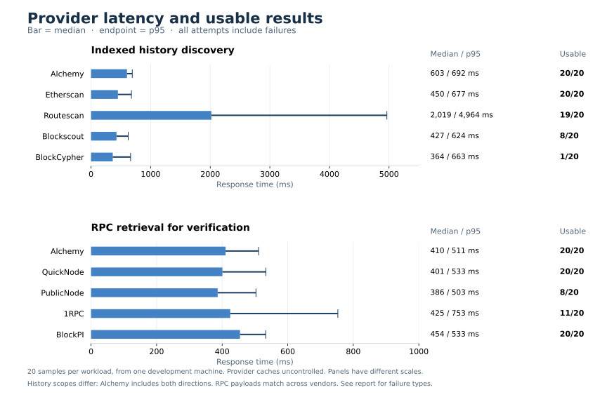

# walletAgeDays: one-second soft deadline and provider latency

Measured November 5, 2026, America/Chicago; raw timestamps use UTC. These are real Python/local-HTTP and provider requests from the development machine. The deployed API policy was not changed.

## Findings

The proposed policy returned a verified age for all 40 known-used controls and reduced their median uncached response time from **1.478 s to 1.182 s**, an observed **20.0% reduction**. Their p95 fell from **2.475 s to 1.473 s**, a **40.5% reduction**. All 100 candidate cold requests finished within three seconds, including errors and malformed inputs.

The speed improvement came from the **one-provider fallback after the one-second soft deadline**: all 40 positive candidate responses used that exit. The two-completed-provider exit was exercised by deterministic tests but did not occur in this live sample. There were still verified observations from more than one partially completed provider in 15 responses; that is distinct from two fully usable provider groups.

Four initial candidate timestamps were later than the baseline. Background refinement corrected all four within the original 2.6-second window. One integer result changed from **55 days to 71 days**. The bounded refinement is therefore necessary if early results are retained indefinitely. After refinement, all 40 candidate epochs matched the baseline; neither baseline agreement nor provider consensus establishes universally exact wallet age.

The recommended provider order is **Alchemy and Etherscan for primary discovery; QuickNode/Alchemy for RPC verification; BlockPI as a measured public RPC fallback**. Keep other public sources for resilience, with their observed availability and history limitations made explicit. This is based on one run, not a long-term SLA or a statistically significant ranking between close RPC timings.

## Algorithm comparison

The unchanged 100-address corpus contains 20 known EOAs, 20 known contracts, 40 format-valid synthetic candidates and 20 malformed inputs. Both primary arms used distinct empty persistent LRU databases and randomized, interleaved arm order per address. Provider jobs ran concurrently; complete source groups rather than individual HTTP responses counted as independent providers.

- **Current baseline:** exact agreement of two independent completed provider groups on the observed minimum, with configured Alchemy history settled; 2.6-second application budget, approximately 2.45 seconds for source work.
- **New candidate:** return with two usable independent providers, without requiring equal timestamps; otherwise return with one usable provider after one second. Hard deadline 2.6 seconds. Retain the smallest verified epoch and allow bounded background MIN updates from already-started lookups.

| Cold cohort | Policy | Inputs | Integer ages | Median | p95 | Maximum | Over 3 s |
| --- | --- | ---: | ---: | ---: | ---: | ---: | ---: |
| Known-used controls | Current | 40 | 40 | 1.478 s | 2.475 s | 2.476 s | 0 |
| Known-used controls | New | 40 | 40 | 1.182 s | 1.473 s | 1.763 s | 0 |
| All valid inputs | Current | 80 | 40 | 1.441 s | 2.468 s | 2.476 s | 0 |
| All valid inputs | New | 80 | 40 | 1.084 s | 1.956 s | 2.619 s | 0 |
| Overall | Current | 100 | 40 | 1.393 s | 2.466 s | 2.476 s | 0 |
| Overall | New | 100 | 40 | 1.018 s | 1.926 s | 2.619 s | 0 |

Both primary policies returned 40 HTTP 200 ages, 40 HTTP 503 unknowns for synthetic candidates, and 20 HTTP 400 invalid-format errors. Malformed inputs made zero provider calls. Synthetic histories were not proven universally absent; unknown results were not changed to age zero. All successful responses used the correct completed-day formula.

For the new policy's 40 positive cache repeats, median full local-HTTP latency was **3.322 ms**, p95 **5.044 ms**, and maximum **5.730 ms**, with **zero upstream attempts**. This is a warmed SQLite experiment with 40 positive entries, not a hosted D1 or one-million-entry capacity measurement. The existing million-entry LRU study remains separate.

## Early-response accuracy tradeoff

| Case | Initial age | Refined/cached age | Epoch improvement | Response | Earlier event available |
| --- | ---: | ---: | ---: | ---: | ---: |
| eth-008 | 55 days | 71 days | 1,399,428 seconds earlier | 1.086 s | 1.351 s |
| eth-005 | 7 days | 7 days | 3,768 seconds earlier | 1.127 s | 1.317 s |
| eth-006 | 8 days | 8 days | 156 seconds earlier | 1.253 s | 1.455 s |
| eth-015 | 25 days | 25 days | 16,044 seconds earlier | 1.242 s | 1.398 s |

Initial epoch agreement with the current baseline was **36/40**; integer-day agreement was **39/40**. Refined epoch agreement was **40/40**. All four earlier observations came from Alchemy. Waiting for its full history group without requiring exact cross-provider agreement is a useful next variant to test; its performance has not been measured as a separate HTTP policy here.

Against 20 independently verified contract-deployment controls, both primary policies matched **17/20** exactly. Both returned later observations for DAI (+320,622 seconds), MKR (+2,861 seconds) and Permit2 (+5,364 seconds). These are shared discovery/verification gaps, not regressions caused by the candidate. Deployment is itself an activity control rather than universal proof of first address appearance, because prefunding and other earlier activity are possible. Exact first-use timestamps are not independently known for all 100 cases, so a universal age-accuracy or fraud-detection percentage would be unsupported.

## One second versus five seconds

The one-second setting is a soft deadline, not a promised response time: a verified provider may only finish at 1.2 seconds. With no verified event, the service waits for completion or the hard deadline.

A real additional five-second sensitivity run used 30 inputs: ten EOAs, ten contracts and ten synthetic candidates. It returned 20 ages and ten unknowns, with no five-second cutoff reached. Its known-used median was 1.110 s and p95 1.432 s; all final epochs matched the corresponding 2.6-second candidate cases. No verified observation arrived after 2.6 seconds, so the longer cap added no observed age benefit in this sample.

This smaller arm ran later, after the primary experiments. Its provider-cache warmth, elapsed-time conditions and quotas differ; its faster median does **not** demonstrate a benefit caused by a five-second setting. Keep the 2.6-second hard deadline for the current three-second application target. Five seconds should not become the default based on this evidence.

The production baseline reserves 150 ms within its budget; the experimental candidate uses the full 2.6 seconds. Post-hoc trace analysis found no candidate whose only positive observation or earlier minimum arrived during the extra 2.45–2.6-second interval. Two candidate responses exceeded 2.45 seconds, both unknowns. The comparison is an operational policy comparison, not a perfectly isolated stopping-rule experiment.

## Provider latency

Twenty distinct existing addresses were tested per provider/workload, ten EOAs and ten contracts. The independent provider phase made 200 HTTP requests. All-attempt latency includes errors; useful-result counts are shown so a fast failure is not interpreted as a successful age lookup.

| Discovery source | Median | p95 | Maximum | Usable candidates |
| --- | ---: | ---: | ---: | ---: |
| Alchemy, both directions in one batch | 603 ms | 692 ms | 833 ms | 20/20 |
| Etherscan, normal history | 450 ms | 677 ms | 792 ms | 20/20 |
| Routescan, normal history | 2,019 ms | 4,964 ms | 5,182 ms | 19/20 |
| Blockscout, normal history | 427 ms | 624 ms | 696 ms | 8/20 |
| BlockCypher, bounded history | 364 ms | 663 ms | 670 ms | 1/20 |

Routescan had one timeout. Blockscout returned twelve rate-limit errors. BlockCypher returned nineteen newest-first truncated histories that could not establish an oldest event. Discovery scopes differ, and an accepted candidate still needs canonical verification. Alchemy includes two billable method calls in its single HTTP batch.

| RPC retrieval source | Median | p95 | Maximum | Usable responses |
| --- | ---: | ---: | ---: | ---: |
| Alchemy | 410 ms | 511 ms | 610 ms | 20/20 |
| QuickNode, authenticated | 401 ms | 533 ms | 576 ms | 20/20 |
| BlockPI, public | 454 ms | 533 ms | 596 ms | 20/20 |
| PublicNode | 386 ms | 503 ms | 554 ms | 8/20 |
| 1RPC | 425 ms | 753 ms | 3,577 ms | 11/20 |

Each RPC provider received the same three-method request for each case: chain ID, a known transaction receipt and finalized head. This measures retrieval needed for verification, not a complete proof or address-history query. PublicNode's twelve rejected cases were older reference cases; the precise cause was not audited. 1RPC produced a mix of HTTP/rate errors and unusable payloads. A sample of twenty provides coarse tail estimates, and a five-second socket timeout can be exceeded by DNS/TLS/connection overhead; timed-out completion latency is censored.



## Provider work and cost

The primary current arm logged 1,146 HTTP-client attempts; the new arm logged 1,131. Twelve current-arm and five candidate-arm attempts were rejected locally by cancellation before dispatch. Excluding those gives 1,134 and 1,126 non-locally-rejected attempts, respectively. Network failures can still precede provider receipt, so these are not billing counts. This run shows little reduction in provider work from the new response policy; retained positive cache entries provide the clear cost saving.

The candidate logged 28 additional client attempts after the initial response snapshot, including five local cancellations. The remaining 23 were not rejected locally. Background refinement starts no new discovery jobs, but a previously started lookup may need to issue receipt/block verification calls after returning to the client. Those calls may be billable. Stopping the response timer does not stop all upstream work.

Experiments ran sequentially under a shared network lock, so the vendor phase did not compete with the algorithm phase. Individual cold starts were paced at least 1.05 seconds apart; Etherscan and Routescan standalone samples were spaced at least 550 ms. These settings respect the documented free-key limits used for planning: [Etherscan limits](https://docs.etherscan.io/rate-limits), [Routescan limits](https://routescan.io/pricing). Quota state and upstream caches could not be reset.

## Scope, artifacts and reproduction

This run covers Ethereum only, one client at a time, an isolated SQLite LRU and the configured credentials. It does not measure hosted Sites latency, EVM aggregate coverage, production concurrency, D1 capacity, or fraud classification. Existing providers' scopes and the quality of their earliest indexed events remain part of the result. The experimental class is confined to `benchmarks/`; production defaults and deployed behavior remain unchanged.

All **344 standard-library unit tests pass**, including fourteen candidate-policy behavior tests and four runner/accounting tests. An independent audit recomputed raw latency statistics, age formulas, cohort counts, SQLite contents, source/corpus hashes, cache-hit provider calls and vendor outcome totals. No runtime provider credentials or private configured URLs were found in the benchmark artifacts.

- [Detailed algorithm report](run-first-response-2026-11-05/REPORT.md), [summary JSON](run-first-response-2026-11-05/summary.json), [per-request evidence](run-first-response-2026-11-05/results.jsonl).
- [Detailed vendor report](run-provider-latency-2026-11-05/REPORT.md), [summary JSON](run-provider-latency-2026-11-05/summary.json), [per-attempt evidence](run-provider-latency-2026-11-05/results.jsonl).
- [Candidate policy](first_response_policy.py), [algorithm runner](run_first_response_benchmark.py), [vendor runner](run_vendor_latency_benchmark.py).

```bash
python3 benchmarks/run_vendor_latency_benchmark.py --env-file .env --output benchmarks/provider-run-new
python3 benchmarks/run_first_response_benchmark.py --env-file .env --output benchmarks/algorithm-run-new
```

Use fresh output directories. The runners share a local network-phase lock, read credentials in memory, and publish no configured secrets or private provider URLs. Database files are isolated experiment state and ignored by Git. The optional plot renderer uses Matplotlib; API and benchmark execution otherwise remain standard-library Python.
