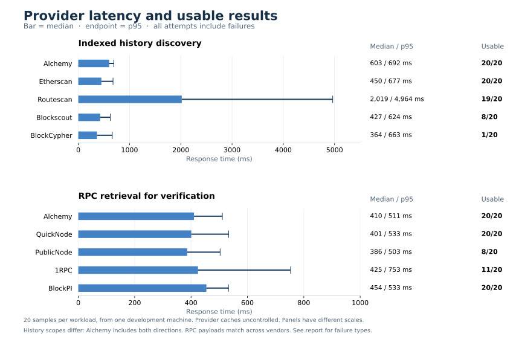

# Independent provider latency benchmark

Completed: 2026-11-06T05:20:55.878322Z

Each provider received 20 distinct existing-address cases (10 EOAs, 10 contracts) from the unchanged 100-address corpus. No application cache was used. Provider caches cannot be cleared. One request per named provider/workload was in flight at a time, with six overall; Alchemy history and Alchemy RPC could overlap (at most two physical Alchemy calls), while other physical vendors had at most one; Etherscan and Routescan dispatches were spaced at least 550 ms.

History queries and RPC verification are different workloads. Alchemy history batches include both directions (two billable RPC methods); the other history requests query one scoped history. Each verification batch contains chain ID, a known receipt and the finalized head (three RPC methods). QuickNode is measured as RPC, not an arbitrary-address history index.

| Provider/workload | Usable / samples | All p50 ms | All p95 ms | All max ms | Usable p50 ms | Timeouts |
| --- | ---: | ---: | ---: | ---: | ---: | ---: |
| alchemy_history | 20/20 | 602.5 | 691.7 | 832.5 | 602.5 | 0 |
| etherscan_history | 20/20 | 450.3 | 677.4 | 791.7 | 450.3 | 0 |
| routescan_history | 19/20 | 2018.7 | 4963.8 | 5181.6 | 1960.0 | 1 |
| blockscout_history | 8/20 | 426.7 | 623.6 | 696.4 | 481.4 | 0 |
| blockcypher_history | 1/20 | 364.1 | 663.2 | 670.2 | 574.7 | 0 |
| alchemy_rpc | 20/20 | 410.4 | 511.1 | 609.7 | 410.4 | 0 |
| quicknode_rpc | 20/20 | 400.7 | 533.4 | 576.1 | 400.7 | 0 |
| publicnode_rpc | 8/20 | 386.3 | 503.1 | 553.9 | 397.3 | 0 |
| 1rpc_rpc | 11/20 | 424.6 | 752.9 | 3576.6 | 493.0 | 0 |
| blockpi_rpc | 20/20 | 454.4 | 532.8 | 596.4 | 454.4 | 0 |

## Outcomes

- `alchemy_history`: `{"usable_candidate": 20}`
- `etherscan_history`: `{"usable_candidate": 20}`
- `routescan_history`: `{"timeout": 1, "usable_candidate": 19}`
- `blockscout_history`: `{"rate_limited": 12, "usable_candidate": 8}`
- `blockcypher_history`: `{"truncated_history": 19, "usable_candidate": 1}`
- `alchemy_rpc`: `{"usable_rpc_response": 20}`
- `quicknode_rpc`: `{"usable_rpc_response": 20}`
- `publicnode_rpc`: `{"invalid_payload": 12, "usable_rpc_response": 8}`
- `1rpc_rpc`: `{"http_error": 4, "invalid_payload": 3, "rate_limited": 2, "usable_rpc_response": 11}`
- `blockpi_rpc`: `{"usable_rpc_response": 20}`

Fast invalid, throttled or truncated responses do not count as useful age data. The `invalid_payload` category includes failed chain/receipt/finality validation and can include unavailable/null receipt data; it does not assert malformed JSON. BlockCypher's newest-first truncated history is rejected for oldest-event discovery. Empty normal history on a contract does not exclude creation/internal/token history. A usable discovery candidate still requires canonical receipt/block/finality verification in the full API.

All-attempt latency includes failures. Timed-out requests are right-censored at their observed wait under the configured 5-second client timeout; DNS/TLS/socket overhead can exceed that setting (observed timeout 5.18 seconds). Their true completion times are unknown, and observed maxima are not an SLA. With only 20 samples, p95 is the 19th ordered sample and tail estimates are coarse. These are provider-response timings from one development machine, not deployed API end-to-end latency or fraud-detection accuracy.

Actual HTTP requests: 200. RPC methods requested: 340. Total wall time: 47.3 seconds. API keys, private endpoint URLs and raw error bodies are excluded from artifacts.
